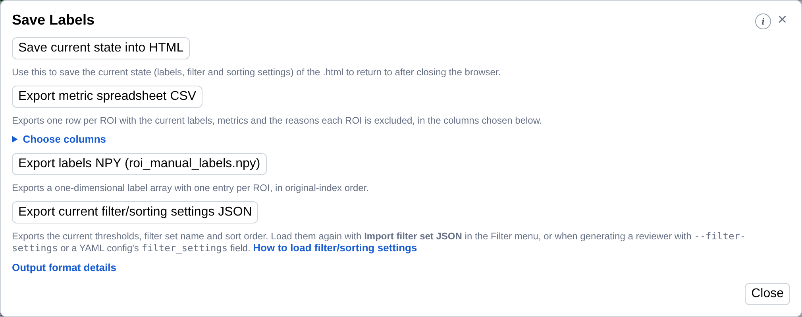

# Export and downstream use

The reviewer opens with every detected ROI, none labeled and no filter applied. The
review path is:

```
all detected ROIs
      |
      v  optional metric filters (Apply Filters labels failing ROIs Bad)
      v  manual and bulk Good / Bad / Unsure / Not labeled review
      v
reviewed HTML, roi_manual_labels.npy, metric spreadsheet CSV, filter settings JSON
```

## What each export contains

<div class="screenshot" markdown>

</div>

| Export (in **Save Labels**) | Contents | Use it for |
|:---|:---|:---|
| **Save current state into HTML** | A new self-contained reviewer with the current labels, thresholds, saved filter sets, sort order and uploaded metrics or labels embedded | Stopping and resuming; sending a reviewed session to someone else |
| **Export metric spreadsheet CSV** | One row per ROI with the [columns you choose](#the-metric-spreadsheet) | Analysis; recording why each ROI was excluded |
| **Export labels NPY (roi_manual_labels.npy)** | One value per original ROI index | Loading reviewed ROIs downstream |
| **Export current filter/sorting settings JSON** (under View and Export) | The active thresholds, the filter set name and the sort order ([format](interface-reference.md#saving-and-importing-filter-sets)) | Reusing a rule on another session with **Import filter set JSON** or `--filter-settings`; citing it alongside a figure |

The page never writes back to the file it was opened from; saving downloads a new copy.
Arrays loaded with **Load dF/F** or **Load inferred spikes** are not embedded in it, so
keep the `.npy` files beside the saved copy.

## The metric spreadsheet

**View ROI metric spreadsheet** opens the table in a new window, with each row colored by
the ROI's current manual QC label (green good, red bad, yellow unsure, white not
labeled). The window is a snapshot taken when it opens; reopen it after more labeling.
**Columns to show and export**, in that window and under **Export metric spreadsheet CSV**,
picks the columns, with **Select all** and **Deselect all**; the two share one selection,
which the browser remembers. `roi_index` is always exported, so every row can be matched
back to its ROI, and uploaded metrics added later are included until you untick them.

| Column | Content |
|:---|:---|
| `roi_index` | The ROI's 0-based [original index](interface-reference.md#original-index-and-sort-position) |
| `manual_QC_label` | `good`, `bad`, `unsure` or `not labeled` |
| `cell_identity_label`, `cell_identity_code` | Cell type/compartment name and code |
| `model_QC_label`, `classifier_score` | The classifier's state and score, when the session has [model scores](inputs.md#roi-model-scores) |
| `footprint`, `skew`, `aspect_ratio`, `compact`, `connectivity`, `roi_area_px` | [Morphology and trace metrics](metrics.md) |
| `snr_95_50`, `caiman_exceptional_event_snr` | Trace SNR metrics |
| `inferred_spike_snr`, `inferred_spike_rise_tau_seconds`, `inferred_spike_decay_tau_seconds` | Inferred spike metrics |
| `inferred_spike_metric_threshold` | The spike threshold those metrics were computed at for that ROI (the generator default, or the value used by **Recompute inferred spike metrics**) |
| `inferred_spike_frames_above_threshold` | The number of frames above that threshold, which the transient estimate used |
| `custom_NAME`, `custom_NAME_label` | Each uploaded metric; the `_label` column holds the names of a categorical variable's codes |
| `reason` | The active thresholds the ROI failed |

Missing numbers are written as `nan`.

## Loading reviewed ROIs

`roi_manual_labels.npy` is a one-dimensional array with one entry per original ROI index:
`NaN` not labeled, `0` bad, `1` good, `2` unsure. `roi_manual_labels[i]` is always the
label of ROI `i`, whatever filtering or sorting happened during review. Placed beside the
Suite2p files, it is read by the loader shipped with the package:

```python
from adroit_qc.roi_metrics import load_reviewed_dff

session = load_reviewed_dff("/path/to/session")
dff         = session["dff"]          # (selected_rois, frames)
roi_indices = session["roi_indices"]  # original ROI indices
```

| `policy` | ROIs returned |
|:---|:---|
| `"good_only"` (default) | Good |
| `"good_or_unsure"` | Good and Unsure |
| `"not_bad"` | Good, Unsure and Not labeled |

`label_path=` reads the labels from another file. Suite2p's original `iscell.npy` is never used implicitly. For masks from other software, read the
spreadsheet CSV and select rows by `manual_QC_label`.

## What to archive

Deposit alongside a result the reviewed HTML (it shows exactly what the reviewer saw),
the filter settings JSON (it states the rule), and the metric spreadsheet CSV (it records
every ROI's metrics, label and exclusion reason at export).
