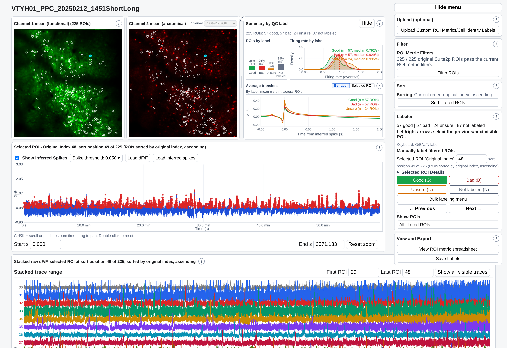

# adROIt-qc

*adroit (adjective), /əˈdrɔɪt/, "uh-DROYT": skillful and quick, especially when handling something difficult.*

This repository builds an interactive, self-contained reviewer for region-of-interest
quality control in two-photon calcium imaging. You point it at a processed session and
it writes a single HTML file that embeds the field-of-view images, the per-ROI masks,
the per-ROI metrics and the review interface itself. A reviewer opens that file in a
browser with no installed software, no server and no network connection, labels ROIs,
and saves the reviewed state back into another self-contained copy.

<div class="screenshot screenshot-tall" markdown>

</div>

## What this repository is for

adROIt-qc is open source; issues, forks and pull requests are welcome on
[GitHub](https://github.com/najafi-laboratory/adROIt-qc). The generator here reads a documented input layout,
so output from any segmentation or deconvolution software can be reviewed, not only
Suite2p. Use it to

* review a session of your own, by writing one configuration file;
* convert output from another pipeline into the documented layout;
* check a converted directory before building, so a silent mismatch is caught early;
* read a complete example of each supported input path.

!!! note "Self-contained"
    `pip install -e .` installs everything the generator needs. No laboratory
    package or cluster environment is required.

## How it fits together

```
your segmentation output
        |
        |  adroit_qc.inputs / scripts/make_standard_inputs.py   (optional converters)
        v
documented input layout  ---->  scripts/validate_inputs.py   (check before building)
        |
        |  scripts/build_reviewer.py config/my_session.yaml
        v
outputs/my_session/
    <name>_interactive_fov_roi_dff.html      the reviewer
    <name>_processing_summary.pdf            static summary
    <name>_dff.npy, <name>_inferred_spikes.npy  sidecar arrays for large sessions
    run.json                                 resolved paths and options
```

For sessions above the embedding threshold the trace arrays are written beside the
HTML as sidecars rather than embedded in it. The HTML and its sidecars must travel
together. They load automatically when the page is opened through a web address, and
are selected with **Load dF/F** and **Load inferred spikes** when it is opened from disk; see
[Whether the arrays load automatically](tutorial.md#whether-the-sidecars-load-automatically).

## Where to start

* [Tutorial](tutorial.md) goes from installation to reviewers built from every kind of
  input: by hand, from your own software's output, and from one script. It links two
  example reviewers you can open without installing anything.
* [Interface Reference](interface-reference.md) shows each panel of the reviewer with the
  full text behind its **(i)** icon.
* [Metric Definitions](metrics.md) gives each metric's equation and the code that computes it.
* [Input Formats](inputs.md) is the reference for every input file.
* [Programmatic Reference](reference.md) lists every build setting, Python helper and
  command-line tool.
* [Build Settings Explained](cli-mapping.md) covers the choices behind the settings.
