# Interface tour

Everything below is one HTML file. The screenshots come from the demo posterior parietal
cortex session: 225 ROIs over 107,135 frames, with an anatomical second channel,
excitatory/inhibitory labels and classifier scores. Each panel's **(i)** icon opens a
short summary; the [Interface Reference](interface-reference.md) has the full text.

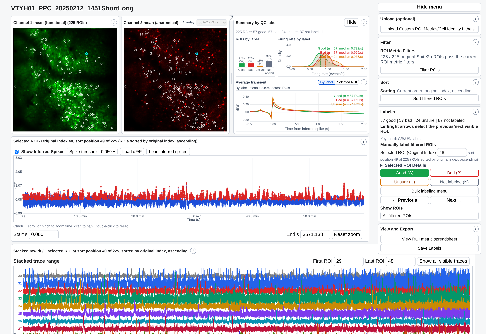

## Field of view and summary

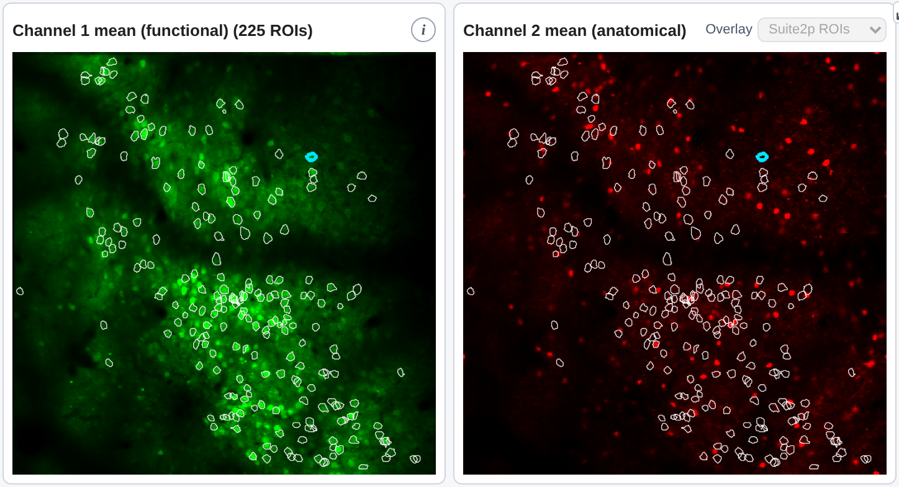

Outlines on each channel's mean image are clickable, and selecting one updates every
linked panel. Beside them, the [summary by QC label](interface-reference.md#summary-of-good-bad-and-unsure-rois)
shows how many ROIs carry each label, their firing rates and their average transients,
and redraws as you label.

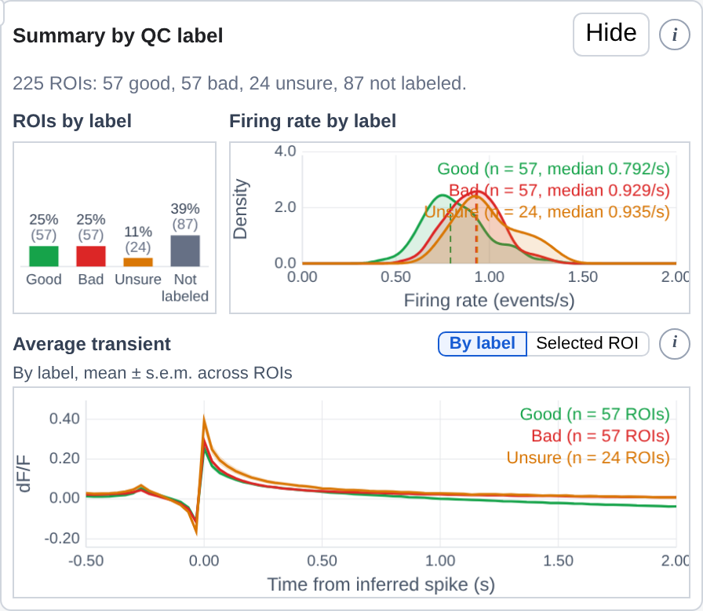

## Selected ROI trace

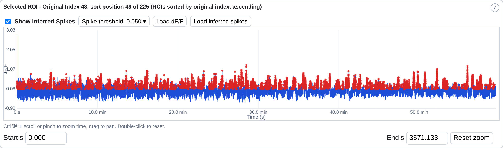

The selected ROI's dF/F, with inferred spikes above the
[spike threshold](interface-reference.md#inferred-spike-threshold) drawn as red dots. The
threshold menu sets raw or per-ROI SD units and a default for all ROIs. Its average
transient, under **Selected ROI** in the summary column, is the check to make when a spike
count looks implausible: an average that does not resemble a calcium event means the
inference has latched onto something else.

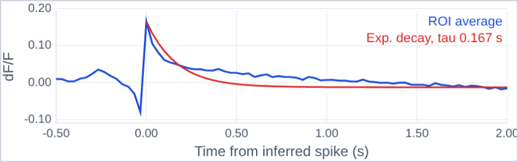

## Metric filters

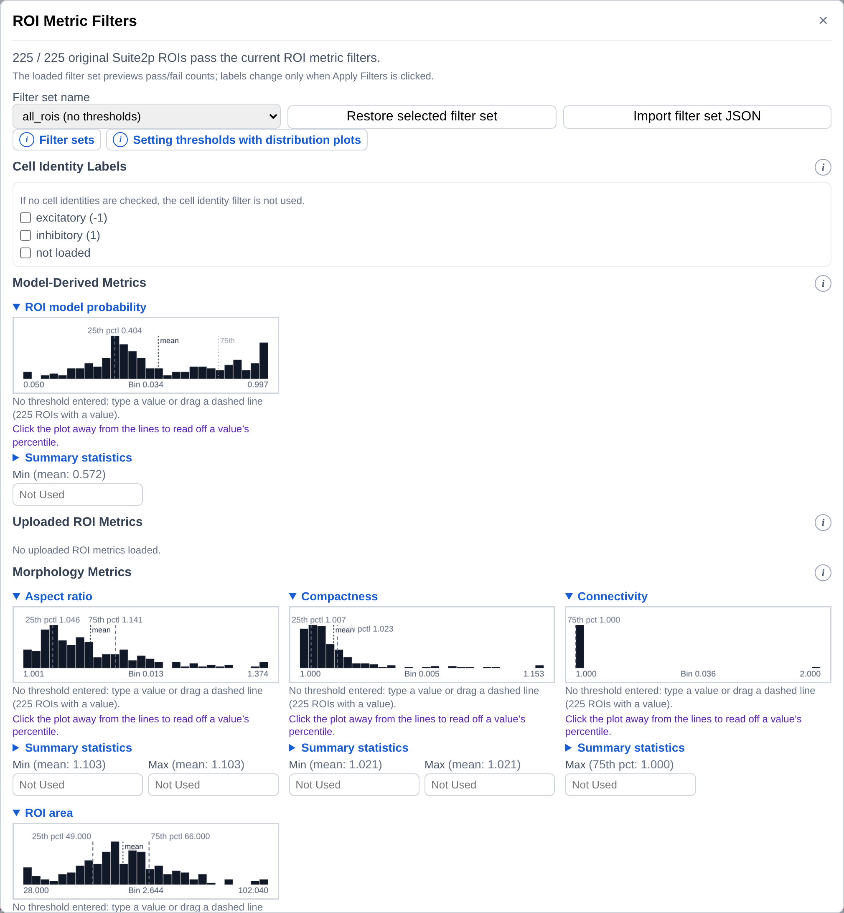

No thresholds are active by default. Each metric's distribution sits above its Min and
Max fields, with the mean and quartiles marked; drag a quartile line to set a threshold
and double-click it to remove it. **Apply Filters** labels failing ROIs Bad
([details](interface-reference.md#filtering-rois)).

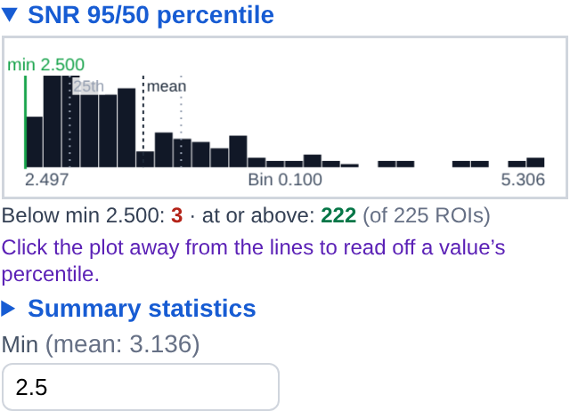

## Sorting

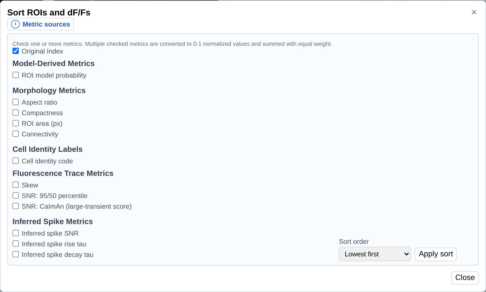

Any metric, or a sum of several normalized metrics, can be the sort key. The sort order
drives arrow-key stepping, so a session can be walked worst-first.

## Labeling

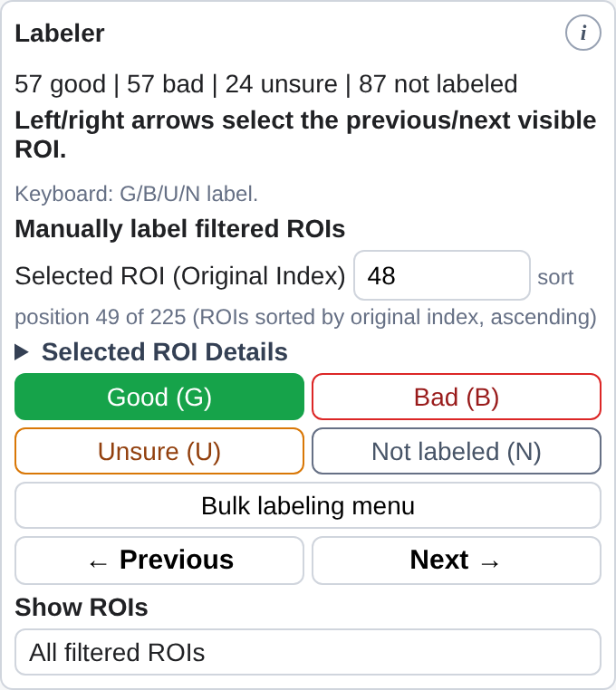

Good, bad, unsure and not labeled, by button or keystroke, with the arrows stepping
through the visible ROIs. **Show ROIs** restricts visibility by label, for example to a
second pass over the unsure ROIs.

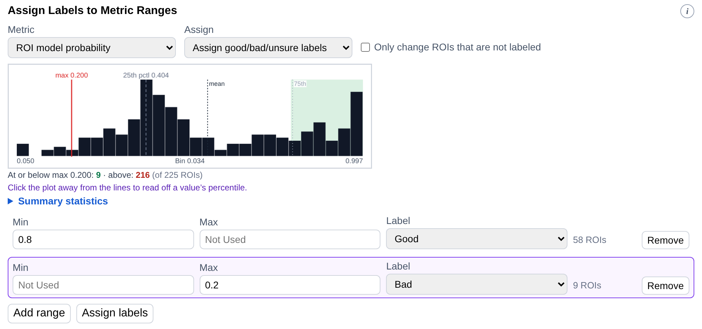

The **Bulk labeling menu** labels every visible ROI at once, or
[labels ROIs from ranges of one metric](interface-reference.md#assigning-labels-to-metric-ranges),
for example a classifier probability, so a rule plus a bulk label is a recorded decision
rather than a long click sequence.

## Export

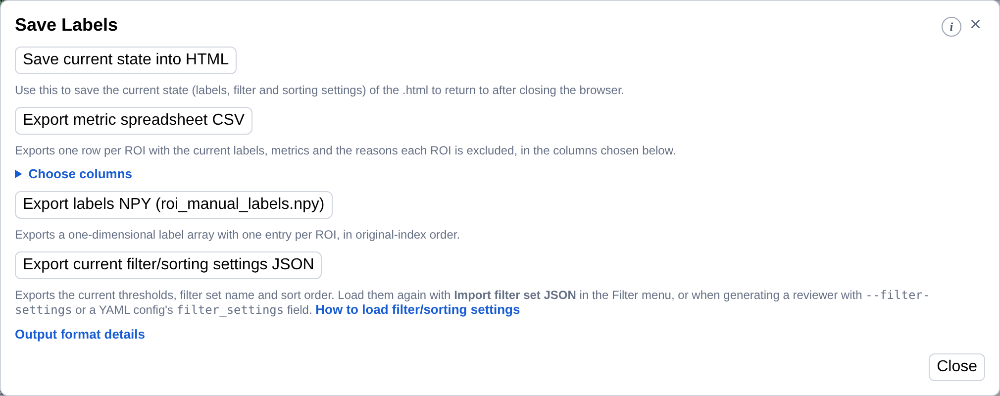

The reviewed state is saved into a new self-contained HTML, and labels, metrics and
filter settings export for analysis ([details](export.md)).

## Stacked traces and motion correction

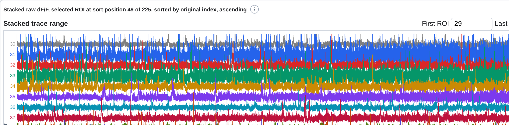

Consecutive ROIs in the current sort order: two rows carrying the same events are two
ROIs sharing a source.

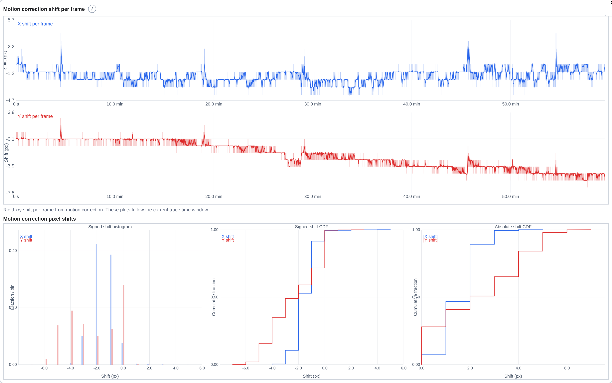

Per-frame rigid shift in the same time window as the traces, with the session's shift
distributions ([input format](inputs.md#motion-offsets)).
