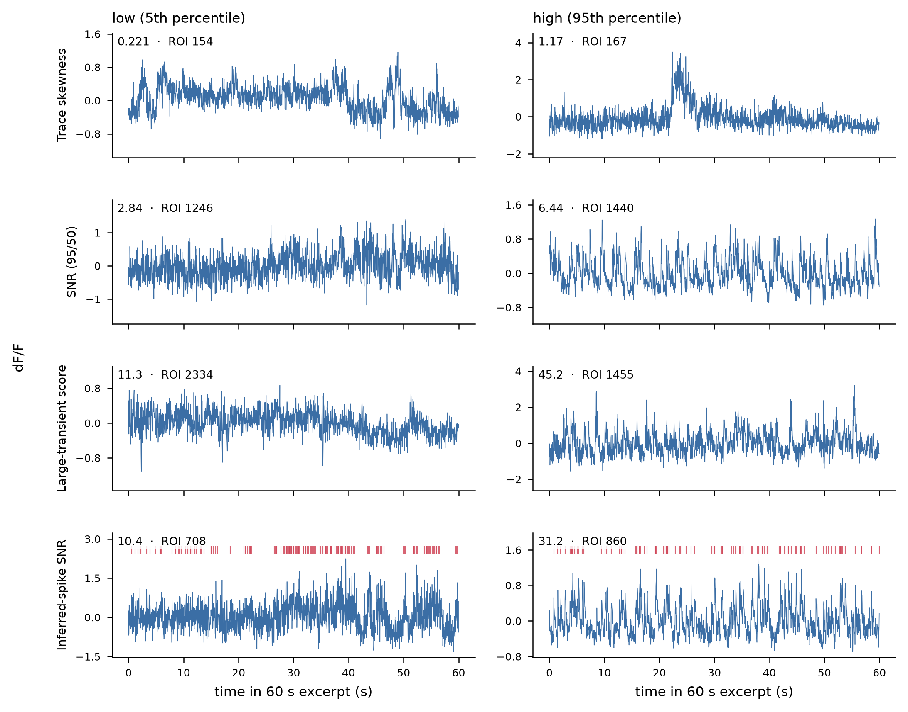

# Metric definitions

Every metric in the reviewer's filter and sort menus is listed here with the column
it maps to in the exported metric spreadsheet. The spreadsheet also carries
`roi_index`, `manual_QC_label`, `model_QC_label`, `cell_identity_code`, one `custom_<name>`
column per uploaded metric (plus `custom_<name>_label` for categorical ones), and `reason`,
listing the active thresholds each ROI failed; the full list is in
[Export and downstream use](export.md#the-metric-spreadsheet). Metrics are named by what they measure;
where a definition comes from another package, the package is cited in the definition.

All metrics are computed once by the generator and embedded per ROI. The browser
filters and sorts on those stored values and never recomputes them, so the numbers a
reviewer sees are the numbers a downstream script reads from the exported CSV.

Fields marked *(Suite2p)* are read from `stat.npy` for a Suite2p session and computed the
same way by the generator for masks from other software, where they can differ slightly;
see [Aspect ratio](#aspect-ratio) and
[Filter sets and masks from other software](cli-mapping.md#filter-sets-and-masks-from-other-software).

| Display name | Export column | Definition | Direction |
|:---|:---|:---|:---|
| **Morphology** | | | |
| [Aspect ratio](#aspect-ratio) | `aspect_ratio` | Elongation from a 2-D Gaussian fitted to the soma-cropped pixels *(Suite2p)* | about 1 round, toward 2 elongated |
| [Compactness](#compactness) | `compact` | Mean pixel distance from the ROI center ÷ that of a disk of equal area *(Suite2p)* | 1 = disk; higher is less compact |
| [Connectivity](#connectivity) | `connectivity` | Number of 4-connected components in the ROI pixel mask | 1 = single component |
| [ROI area](#roi-area) | `roi_area_px` | Number of pixels in the ROI mask | n/a |
| Footprint | `footprint` | Suite2p detection-scale index; see the warning below. Not defined for masks from other software (blank) | n/a |
| **Cell identity** | | | |
| Cell identity code | `cell_identity_code` | Integer cell type/compartment code ([sources](inputs.md#uploaded-metrics-and-categorical-labels)) | Categorical |
| Cell identity label | `cell_identity_label` | Name of the code | Categorical |
| **Model derived** | | | |
| [Classifier score](#classifier-score) | `classifier_score` | A classifier's 0 to 1 score from the [ROI model scores file](inputs.md#roi-model-scores); ranks ROIs, not a calibrated probability | Higher = rated more likely good |
| **Fluorescence trace** | | | |
| [Skew](#skew) | `skew` | Skewness of the fluorescence trace *(Suite2p)*. External masks: skewness of the raw fluorescence row | n/a |
| [SNR: 95/50 percentile](#snr-9550-percentile) | `snr_95_50` | Robust transient amplitude (95th − 50th percentile of dF/F) ÷ residual noise | Higher = stronger transients relative to noise |
| [SNR: CaImAn (large-transient score)](#snr-caiman-large-transient-score) | `caiman_exceptional_event_snr` | Exceptional-event score after CaImAn | Higher = stronger large transients |
| **Inferred spikes** | | | |
| [Inferred spike SNR](#inferred-spike-metrics) | `inferred_spike_snr` | Peak of the ROI's regression-estimated transient minus its pre-event mean, ÷ SD of its pre-event values; for a given ROI more events make the estimate less noisy, but threshold crossings caused by noise lower it | Higher = events stand out from baseline |
| [Inferred spike rise tau](#inferred-spike-metrics) | `inferred_spike_rise_tau_seconds` | Time between the 10% and 90% crossings of the regression-estimated transient | n/a |
| [Inferred spike decay tau](#inferred-spike-metrics) | `inferred_spike_decay_tau_seconds` | Time constant of an exponential fitted to the regression-estimated transient from its peak | n/a |

Metrics you supply yourself appear under **Uploaded ROI Metrics**, either from
`custom_roi_metrics` at build time or uploaded into an open reviewer; see
[Uploaded metrics and categorical labels](inputs.md#uploaded-metrics-and-categorical-labels).

!!! warning "`footprint` is a detection scale, not a shape"
    Suite2p's `footprint` field is the spatial scale at which an ROI was detected and
    takes only small integer values (0 to 3 in the cerebellar example). A preset window on
    it selects detection scales, not shapes. It has no equivalent for masks from other
    software, so it is left blank for them.

## Definitions

The equations below are the generator's computations, with a link to the code that
implements each. Notation: $P$ is the set of an ROI's pixels with weights $\lambda_p$
(1 for a binary mask), $x(t)$ is its dF/F at frame $t$, $T$ the number of frames and $f$
the frame rate in Hz.

### dF/F {#dff}

Computed as Suite2p does, unless a `dff.h5` is [supplied](inputs.md#dff-and-inferred-spikes):

$$
x(t) = \frac{S(t) - B(t)}{B(t)}, \qquad S(t) = F(t) - c\,F_{\mathrm{neu}}(t), \qquad B = G_{600} * S
$$

where $c$ is the neuropil coefficient (`neucoeff` in `ops.npy`, or `neuropil_coefficient`
in the metadata file; default 0.7) and $G_{600}$ a Gaussian filter along time with
$\sigma = 600$ frames. Code: [`_load_suite2p_dff`, summary.py lines 749–761](https://github.com/najafi-laboratory/adROIt-qc/blob/15138813a5f0bb58f22f1542ed4c1f0755bbda2f/adroit_qc/summary.py#L749-L761).

### ROI area {#roi-area}

$A = |P|$, the number of distinct pixels, each counted once whatever its weight.

### Connectivity {#connectivity}

The number of 4-connected components of $P$ (pixels joined through their up, down, left
and right neighbors). Code: [`_connected_components_4`, roi_metrics.py lines 65–77](https://github.com/najafi-laboratory/adROIt-qc/blob/15138813a5f0bb58f22f1542ed4c1f0755bbda2f/adroit_qc/roi_metrics.py#L65-L77).

### Soma crop

Compactness and aspect ratio are computed on Suite2p's soma crop $P_s \subseteq P$: the
weight enclosed within radius $r$ of the ROI center is evaluated at $r = 0, 1, 2, \dots$
pixels, and the crop ends at the first radius where its growth, having risen above one
third of its largest one-pixel increase, falls back below it. ROIs of 10 pixels or fewer
are not cropped. Code: [`_soma_crop_mask`, summary.py lines 1447–1476](https://github.com/najafi-laboratory/adROIt-qc/blob/15138813a5f0bb58f22f1542ed4c1f0755bbda2f/adroit_qc/summary.py#L1447-L1476).

### Compactness {#compactness}

With pixel distances from the crop's median position, scaled by the expected diameter
$(D_y, D_x)$ (default 12 pixels),

$$
d_p = \sqrt{\left(\frac{y_p - \tilde y}{D_y}\right)^2 + \left(\frac{x_p - \tilde x}{D_x}\right)^2},
\qquad
\mathrm{compact} = \max\!\left(1,\; \frac{\tfrac{1}{|P_s|}\sum_{p \in P_s} d_p}{\tfrac{1}{|P_s|}\sum_{j=1}^{|P_s|} d^{\,\mathrm{disk}}_{(j)}}\right)
$$

where $d^{\,\mathrm{disk}}_{(j)}$ are the $|P_s|$ smallest distances of a pixel grid from its
center, that is, the pixels of an ideal disk of the same size. A disk scores 1; larger is
less compact. Code: [`suite2p_shape_stats`, summary.py lines 1504–1546](https://github.com/najafi-laboratory/adROIt-qc/blob/15138813a5f0bb58f22f1542ed4c1f0755bbda2f/adroit_qc/summary.py#L1504-L1546) and [`_disk_reference_distances`, summary.py lines 1479–1486](https://github.com/najafi-laboratory/adROIt-qc/blob/15138813a5f0bb58f22f1542ed4c1f0755bbda2f/adroit_qc/summary.py#L1479-L1486).

### Aspect ratio {#aspect-ratio}

The weighted covariance of the cropped pixels' scaled coordinates has eigenvalues
$\sigma_1^2 \ge \sigma_2^2$, giving radii $r_i = 2\sigma_i$ of a fitted 2-D Gaussian:

$$
\mathrm{aspect} = \frac{2\, r_1}{r_1 + r_2 + 0.01}
$$

About 1 for a round ROI, approaching 2 for an elongated one. Code: [`_ellipse_radii`, summary.py lines 1489–1501](https://github.com/najafi-laboratory/adROIt-qc/blob/15138813a5f0bb58f22f1542ed4c1f0755bbda2f/adroit_qc/summary.py#L1489-L1501).

For Suite2p sessions compactness and aspect ratio are read from `stat.npy`; for masks from
other software they are computed as above, which matches Suite2p exactly given the same
pixel weights and ROI center
([why values can differ](tutorial.md#where-the-defaults-differ-from-suite2p)).

### Skew {#skew}

$$
\mathrm{skew} = \frac{1}{T}\sum_t \left(\frac{F(t) - \bar F}{\sigma_F}\right)^3
$$

Suite2p's `skew` for Suite2p sessions; for masks from other software, the skewness of the
raw fluorescence row $F$. Code: [`_trace_skew`, summary.py lines 1401–1412](https://github.com/najafi-laboratory/adROIt-qc/blob/15138813a5f0bb58f22f1542ed4c1f0755bbda2f/adroit_qc/summary.py#L1401-L1412).

### SNR: 95/50 percentile {#snr-9550-percentile}

$$
\mathrm{SNR}_{95/50} = \frac{P_{95}(x) - P_{50}(x)}{1.4826\;\operatorname{median}_{t \in \mathcal{B}}\bigl|\,r(t) - \operatorname{median}_{\mathcal{B}}(r)\bigr|},
\qquad r = x - G_3 * x
$$

The numerator is a robust transient amplitude. The denominator is the noise: the scaled
median absolute deviation of the high-frequency residual $r$ ($G_3$, a Gaussian with
$\sigma = 3$ frames), over the frames $\mathcal{B}$ more than 5 frames from any frame above
the 80th percentile of $x$, so transients do not inflate it. Code: [`robust_event_snr`, roi_metrics.py lines 126–162](https://github.com/najafi-laboratory/adROIt-qc/blob/15138813a5f0bb58f22f1542ed4c1f0755bbda2f/adroit_qc/roi_metrics.py#L126-L162).

### SNR: CaImAn large-transient score {#snr-caiman-large-transient-score}

After CaImAn's component evaluation. With $m$ the half-sample mode of $x$ and $\sigma$ the
noise estimated from the values below it,

$$
\sigma = \sqrt{\frac{\sum_{x(t) < m} \bigl(m - x(t)\bigr)^2}{\#\{t : x(t) < m\}}},
\qquad
z(t) = \frac{x(t) - m}{3\sigma},
\qquad
\mathrm{score} = -\min_t \sum_{i=0}^{4} \log\bigl(1 - \Phi(z(t-i))\bigr)
$$

where $\Phi$ is the standard normal distribution function. Five consecutive frames that
are each improbably high under the noise model give a large score. Code: [`half_sample_mode and the score function`, roi_metrics.py lines 165–240](https://github.com/najafi-laboratory/adROIt-qc/blob/15138813a5f0bb58f22f1542ed4c1f0755bbda2f/adroit_qc/roi_metrics.py#L165-L240).

### Inferred spike metrics {#inferred-spike-metrics}

All three come from one regression estimate of the ROI's average transient. With
$\hat s(t)$ the inferred-spike array and $\theta$ the threshold, let
$s(t) = \mathbb{1}[\hat s(t) > \theta]$. Then

$$
x(t) = c + \sum_{\ell = -L_-}^{L_+} k(\ell)\, s(t - \ell) + \varepsilon(t),
\qquad L_- = \mathrm{round}(0.5 f),\; L_+ = \mathrm{round}(2 f)
$$

and $k$ and $c$ are found by least squares (with a $10^{-6}$ ridge on $k$). Overlapping
events add their transients, so bursts do not distort the estimate as they do an
event-triggered average. At least 3 frames above $\theta$ are needed. From $k$, with
pre-event mean $b$ and standard deviation $\sigma_b$ of $k(\ell)$ for $\ell < 0$, peak lag
$\ell^\ast = \arg\max_{\ell \ge 0} k(\ell)$ and amplitude $A = k(\ell^\ast) - b$:

$$
\mathrm{SNR} = \frac{A}{\sigma_b},
\qquad
\tau_{\mathrm{rise}} = \frac{\ell_{90} - \ell_{10}}{f},
\qquad
\tau_{\mathrm{decay}} = \arg\min_{\tau} \min_{a} \sum_{j \ge 0} \Bigl(k(\ell^\ast + j) - b - a\, e^{-j/(f\tau)}\Bigr)^2
$$

where $\ell_{10}$ and $\ell_{90}$ are the interpolated lags, before the peak, at which $k$
crosses $b + 0.1A$ and $b + 0.9A$. The decay fit searches $\tau$ from half a frame to 10 s;
when it finds no interior minimum, the interpolated time for $k$ to fall to $b + A/e$ is
used instead. Code: [`_inferred_spike_kernel`, summary.py lines 1260–1346](https://github.com/najafi-laboratory/adROIt-qc/blob/15138813a5f0bb58f22f1542ed4c1f0755bbda2f/adroit_qc/summary.py#L1260-L1346) and [`_fit_exponential_decay`, summary.py lines 1221–1257](https://github.com/najafi-laboratory/adROIt-qc/blob/15138813a5f0bb58f22f1542ed4c1f0755bbda2f/adroit_qc/summary.py#L1221-L1257).

For the same transient, more events give a less noisy $k$ and a higher SNR; threshold
crossings caused by noise add events that carry no transient and lower it. One inferred
spike that spreads over several frames contributes one copy of $k$ per frame above
threshold, so $A$ is an amplitude per frame above threshold rather than a whole transient;
the shape and time constants are unaffected. The spreadsheet's
`inferred_spike_frames_above_threshold` column gives the number of frames used, and
`inferred_spike_metric_threshold` the threshold
([recomputing at another threshold](interface-reference.md#inferred-spike-metrics)).

### Firing rate {#firing-rate}

Shown in the [summary by QC label](interface-reference.md#summary-of-good-bad-and-unsure-rois).
Events are frames with $\hat s(t) > \theta$ at least $\mathrm{round}(0.25 f)$ frames after
the previous event, counted over the frames that have a full window around them:

$$
\mathrm{rate} = \frac{N_{\mathrm{events}}}{(T - L_- - L_+)/f}\ \ \text{events/s}
$$

Code: [`thresholdEvents and gbuRoiSummary`, summary.py lines 6335–6388](https://github.com/najafi-laboratory/adROIt-qc/blob/15138813a5f0bb58f22f1542ed4c1f0755bbda2f/adroit_qc/summary.py#L6335-L6388).

### Classifier score {#classifier-score}

A classifier's score $s_i \in [0, 1]$ per ROI, read from `roi_model_scores.h5`
([format](inputs.md#roi-model-scores)). Its state is good if $s_i \ge \theta_{\mathrm{good}}$,
bad if $s_i \le \theta_{\mathrm{bad}}$ and gray (Undetermined) otherwise. The score ranks
ROIs; it is not a calibrated probability.

## What low and high values look like

Metric definitions are easier to threshold once you have seen traces at either end of
the range. Each row below is one metric: on the left the ROI nearest that metric's 5th
percentile in the cerebellar example session, on the right the ROI nearest its 95th,
as 60-second excerpts centered on a representative inferred event. Vertical scales
differ between panels.

A low-skew ROI fluctuates around its baseline; the high-skew exemplar sits near
baseline and departs from it once, upward. The inferred-spike SNR pair is the clearest:
at the low end events sit within the surrounding fluctuations, at the high end they are
unambiguous.

The exemplars were drawn only from ROIs with 20–400 pixels, at most three connected
components, and |dF/F| ≤ 20. In this session (before its seven hand-drawn duplicate ROIs were removed) 332 of
2,702 ROIs exceed |dF/F| = 20,
values no calcium indicator produces, which arise when the baseline denominator
approaches zero. Those ROIs take extreme values on several metrics at once, so they
would have illustrated a division artifact rather than the metric. They are exactly the
ROIs review exists to catch.
